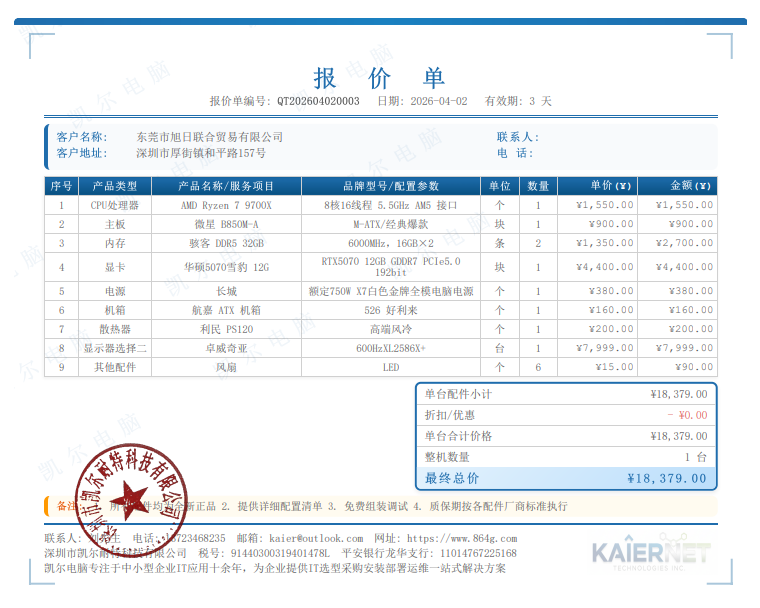
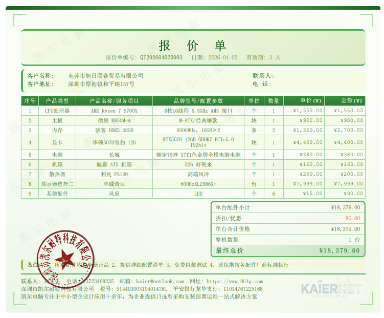
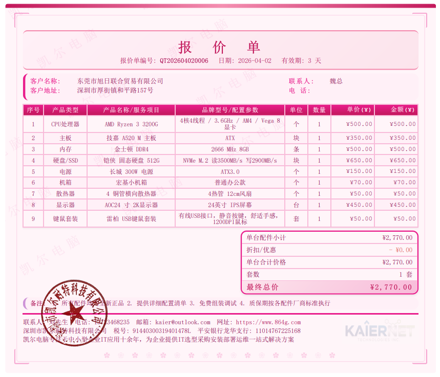
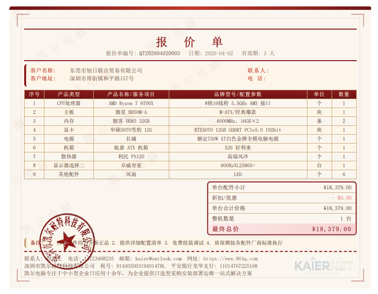
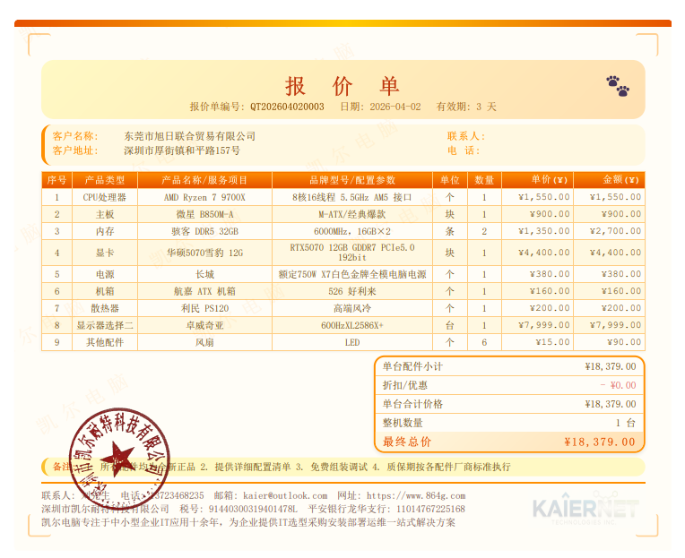
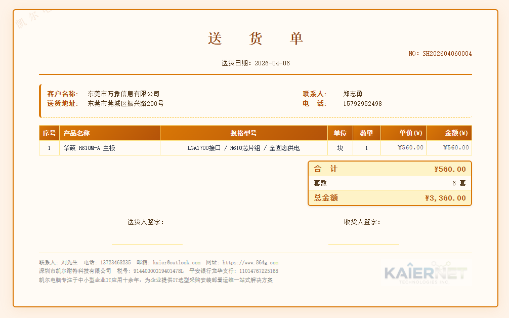
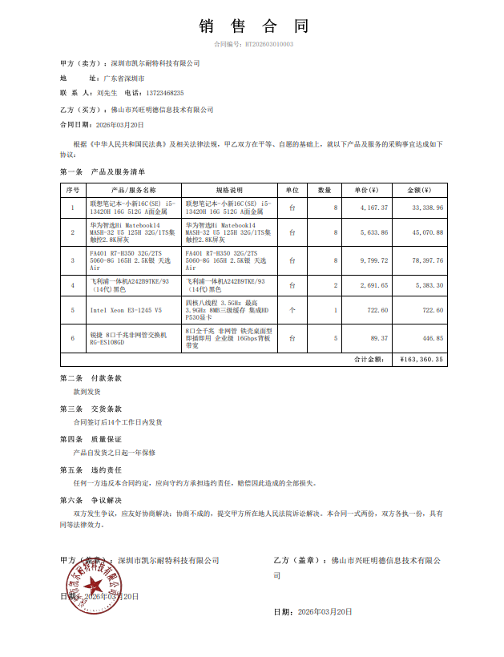

# 三十秒报价 ERP｜电脑装机与强弱电工程业务管理系统

> 面向电脑销售、装机、IT 服务，以及强弱电与安防工程商的业务管理系统。围绕产品和库存、报价、合同、送货、维修、回收、收付款与项目成本，帮助团队把日常业务放进一套连贯的流程中管理。

**项目版本：v1.5.1** · **技术栈：PHP 7.4 / MySQL 5.7 / 原生 HTML、CSS 与 JavaScript** · **许可证：MIT**

## 客户等着报价，别再让一张单子耗掉一上午

早上刚接到客户的电脑配置或工程需求，你还要翻产品表找型号、逐项核价、排报价清单，再根据客户修改来回调整报价和合同。一上午过去了，客户还在等回复。

现在，从 **3 万级产品库**快速选型，套用报价与合同模板，常见业务约 **30 秒**即可完成报价和合同。少花时间核对品牌、型号和参数，把精力留给跟进客户和交付项目。

## Windows 64 位单机版：下载即用

> **每个电脑店必备的管理系统：管货物、管客户、管供应商、管账、管序列号、管合同、管方案、管维修、管送货，管天管地管天气。**

没有服务器也可以使用。在 Windows 64 位电脑上下载并解压官方本地集成版，按包内说明启动即可；无需自行安装 PHP、MySQL 或部署服务器，基础版功能不设限制。

- [前往 GitHub Releases 下载 v1.5.0 Windows 本地集成版](https://github.com/kaier0922/myerp/releases)
- [直接下载 Windows 集成包 v1.5.0](https://github.com/kaier0922/myerp/releases/download/v1.5.0/ERP_v1.5_20261010.zip)
- [查看文件校验信息](https://github.com/kaier0922/myerp/releases/download/v1.5.0/ERP_v1.5_20261010.sha256_md5.txt)
- [查看 v1.5.0 发布说明](https://github.com/kaier0922/myerp/releases/tag/v1.5.0)

> 当前 GitHub 源码版本为 v1.5.1；已发布的 Windows 集成包为 v1.5.0。没有服务器的个人或小型团队可直接使用 Windows 集成包；需要多人远程访问时，再选择服务器或 NAS 部署。

## 手机端与后续部署方式

- **手机移动端：** 已可使用手机创建报价、查询方案与合同，方便外出拜访、现场运维和项目跟进。手机移动端目前未开源；如需使用，可联系作者代为将主系统与移动端部署到公网，并赠送一个类似 [www.864g.com](https://www.864g.com) 的访问域名。
- **Docker 版本：** 正在内测，计划近期推出。

---

## 在线演示

- **演示地址：** [www.980g.com](https://www.980g.com)（早期 v1.1 演示环境，功能与当前 v1.5.1 代码版本存在差异）
- **演示账号：** 手机号 `13800138000`，密码 `13800138000`
- **演示视频：** [v1.1 演示视频](https://github.com/kaier0922/myerp/releases/download/v1.1.0/demo.mp4)

> 演示环境仅供体验，数据为测试数据并可能定期清理。请勿录入真实客户、产品或财务数据。

## 📸 系统界面

按单证类型和打印风格展示；每张截图单独一行。

### 报价单风格

<p><strong>商务经典</strong><br></p>

<p><strong>草原风格</strong><br></p>

<p><strong>少女风格</strong><br></p>

<p><strong>中式红印</strong><br></p>

<p><strong>宠萌风格</strong><br></p>

报价单还支持极简墨白、奢华金典、卡通、太空和机器等风格。

### 其他业务单据

<p><strong>送货单</strong><br></p>

<p><strong>销售合同</strong><br></p>

<p><strong>收据</strong><br></p>

<p><strong>维修工单</strong><br></p>


## ✨ 功能模块

以下模块与系统侧边栏的“主要功能”“基础数据”“公司设置”“系统管理”和“帮助与支持”分组对应。

### 主要功能

- **🏠 工作台** — 汇总客户、供应商、产品、报价、合同、维修及应收应付数据；展示逾期提醒、本月收支和近期业务单据
- **📋 报价管理** — 提供组装电脑、品牌整机、弱电工程和强电工程报价；支持常用配置、审核、利润核算、单据风格、打印及 Word/Excel 导出；可选择开票方式并按公司设置计算报价加收金额
- **📐 方案管理** — 管理 IT 技术方案，记录项目技术细节和实施内容，支持附件
- **📝 合同管理** — 管理销售、施工、IT 外包和租赁等合同；参照《民法典》标准格式并结合实际业务场景优化合同模板，记录条款，跟踪草稿、生效、完成及取消状态
- **🚚 送货管理** — 从已审核报价生成送货单，支持自送、快递和虚拟发货；跟踪审核、送货状态及收款，并支持打印和导出
- **🔧 维修管理** — 登记上门或带回维修工单，记录设备、故障、配件和费用，跟踪维修进度与工程师处理；支持打印 58mm/80mm 热敏小票
- **♻️ 电脑回收** — 登记二手设备回收、付款和验机结果，跟踪回收成本及转卖、拆件、报废等处置进度
- **💰 财务管理** — 管理应收、应付与收付款记录；支持由送货单生成应收、收款生成收据，并提供收据管理、利润报表和总账
- **📊 项目成本** — 按项目汇总应付账单与人工成本，跟踪项目成本并核算毛利

### 基础数据

- **🏢 客户管理** — 维护客户档案、标签和客户简称，支持导入导出
- **🚚 供应商管理** — 维护供应商档案，支持导入导出
- **📦 产品管理** — 管理 SKU、分类、采购入库、销售出库、租借、库存、序列号和价格历史；支持产品导入导出，并可进入退换货管理（RMA）

### 公司设置

- **⚙️ 公司设置** — 配置公司资料、报价与开票加收比例、报表页脚、水印和 Logo；详见[报价开票加收规则](QUOTE_INVOICE_TAX.md)
- **🔏 公章管理** — 管理电子公章，并用于报价单、送货单和合同等业务单据
- **👥 用户管理** — 管理系统用户及角色权限

### 系统管理

- **🛡️ 系统管理** — 管理系统版本与更新
- **📋 操作日志** — 查看系统操作和登录记录

### 帮助与支持

- **💬 问题反馈** — 提交功能建议或问题，并跟踪回复

## 项目特点

### 从报价到回款的业务衔接
报价、合同、送货、应收和收款记录可以衔接处理，减少重复录入，并便于追踪订单执行和回款情况。

### 产品库存与售后流程
采购入库、销售出库、租借、序列号追踪和返修等功能围绕产品资料协同，帮助记录库存变化与设备流转。

### 面向客户的单据输出
报价单、送货单、合同和收据支持公司信息与单据风格配置；报价、送货及合同可使用电子公章。

## 🛠️ 技术栈

- **后端：** PHP 7.4
- **数据库：** MySQL 5.7
- **Web服务器：** Nginx
- **运行环境：** Ubuntu 22
- **短信服务：** 腾讯云SMS（验证码登录）
- **前端：** 原生 HTML/CSS/JS，无框架依赖

---

## 源码服务器部署（可选）

### 环境要求

- PHP 7.4
- MySQL 5.7
- Nginx（或已正确配置 PHP 的 Apache）
- PHP-FPM 与 Web 服务的连接方式按实际服务器配置

### 获取代码与配置

```bash
git clone https://github.com/kaier0922/myerp.git
cd myerp
cp config.example.php config.php
cp sms_config.example.php sms_config.php
```

编辑本地 `config.php`，填写数据库地址、数据库名、账号、密码、邮件配置和授权密钥。需要短信登录时，再填写 `sms_config.php` 中的腾讯云短信配置。不要将包含真实密钥的本地配置提交到 GitHub。

### 数据库初始化状态

> 当前仓库尚未提供完整的全新安装数据库结构文件，因此仅凭本仓库无法完成空数据库初始化。部署前需要获取与 v1.5.1 匹配的空库结构包。仓库中的迁移脚本不能替代初始化结构；执行迁移前应先备份数据库。

### Nginx 配置参考

按服务器上的 PHP-FPM socket 和项目实际路径调整以下配置：

```nginx
server {
    listen 80;
    server_name example.com;
    root /var/www/myerp;
    index index.php index.html;

    location ~ \.php$ {
        include fastcgi_params;
        fastcgi_param SCRIPT_FILENAME $document_root$fastcgi_script_name;
        fastcgi_pass unix:/run/php/php7.4-fpm.sock;
    }

    location ~* ^/uploads/.*\.(php|php5|phtml)$ {
        deny all;
    }

    location ~ /\. {
        deny all;
    }
}
```

上传目录需要由 Web 服务账号按最小权限写入。正式环境应启用 HTTPS，并限制诊断、迁移等管理脚本的访问。

## 目录结构

仓库只提交配置模板，不提交部署环境使用的本地密钥配置。

```text
myerp/
├── config.example.php       # 数据库、邮件及授权配置模板
├── sms_config.example.php   # 腾讯云短信配置模板
├── login.php                # 登录入口
├── index.php                # 工作台
├── sidebar.php              # 侧边栏导航
├── navbar.php               # 顶部导航
├── quotes.php               # 报价管理
├── quote_create*.php        # 报价创建页面
├── quote_edit_*.php         # 报价编辑页面
├── deliveries.php           # 送货管理
├── repair.php               # 维修管理
├── recycle.php              # 电脑回收
├── finance.php              # 财务管理
├── project_list.php         # 项目成本
├── customers.php            # 客户管理
├── suppliers.php            # 供应商管理
├── products.php             # 产品管理
├── rma.php                  # 退换货管理
├── settings.php             # 公司设置
├── seals.php                # 公章管理
├── users.php                # 用户管理
├── sysadmin.php             # 系统管理
├── system_logs.php          # 操作日志
├── feedback.php             # 问题反馈
├── env_check.php            # 环境诊断
├── migrate_from_11.php      # 旧版本迁移程序
├── QUOTE_INVOICE_TAX.md     # 报价开票加收规则说明
└── docs/images/             # 系统截图
```

## 📋 更新日志

### 2026-11
- 新增报价开票方式选择：电子普票、一般纳税人13%专票、小规模纳税人3%专票互斥选择；默认电子普票不加收，专票客户加收比例默认分别为10%和3%
- 在公司设置中增加可调整的报价开票加收比例；报价创建、编辑和预览统一展示开票方式、客户加收金额及含加收总价，并保存报价当时的比例
- 为报价数据增加开票类型、票面税率和客户加收比例字段
- 修复送货单“从报价单导入”误显示未审核报价的问题：选择未审核报价时必填信息无法正常带入并导致报错；导入列表与数据接口现均限制为已审核且已确认/已成交的报价
- 优化应收账款收款页面：支持一键填入全部待收金额，同时保留部分收款手动输入；收款方式、收款日期和生成收据选项紧凑排版并适配窄屏
- 统一收款页面顶部导航风格，增加返回应收账款入口；优化账款信息与收款金额控件的显示
- 新增报价开票与客户加收比例的配置说明文档
- 整理部署配置模板，将本地数据库/邮件/授权配置加入忽略规则
- 将运行时上传目录与源码分离，并加入忽略规则，避免上传图片混入代码仓库

### 2026-10
- 优化合同生成：参照《民法典》合同标准格式，并结合实际业务场景完善合同内容与流程，将合同制作时间从半天缩短到约30秒
- 优化收据金额大写：增加按常用财务书写习惯将数字金额自动转换为中文大写金额

### 2026-09
- 新增项目成本管理模块

### 2026-08
- 应用同行要求，新增电脑回收模块

### 2026-07
- 报价单新增利润核算开关，一键切换查看成本与毛利润，默认关闭不影响客户看到的报价内容
- 维修管理新增小票打印，支持58mm/80mm热敏打印机专用模板，打印后可直接贴在设备上标识状态
- 新增退换货管理（RMA）模块
- 财务模块新增利润报表
- 新增客户反馈管理
- 客户管理新增客户简称字段
- 报价单/送货单新增审批流程、批量删除、快速复制功能
- 收据管理独立成模块，支持导出 Word/Excel

### 2026-06
- 合同管理正式上线，支持创建/编辑、合同模板（已升级）、导出 Word/Excel
- 报价单新增常用配置，保存常用整机配置组合，报价时一键调用
- 客户档案增加导入导出，产品管理的导入导出能力升级为批量处理
- 公章管理功能增强，优化拖拽定位选择器
- 短信验证码登录与密码找回流程完善
- 新增登录历史、系统操作日志
- 项目核算完善，自动关联送货、应付账款与人工成本汇总

### 2026-05
- 新增项目核算
- 发布WINDOWS上运行的本地集成环境程序包

### 2026-04
- 新增验证码登录/注册
- 新增报价单多套加和
- 新增文件上传类型安全校验
- 完善数据库安全问题，防SQL注入

### 2026-03
- 送货单新增三种发货方式（自送/快递/虚拟发货）
- 报价单新增多套打印风格
- 完善公章拖拽定位逻辑

### 2025-12
- 新增组装机报价兼容性校验
- 新增序列号追踪功能
- 新增财务管理模块

### 2025-11
- 完善产品库存业务联动，逐步打通采购、销售、租借与返修过程中的库存流转

### 2025-10
- 产品管理增加产品数据导入、导出能力，便于整理和迁移产品资料

### 2025-09
- 增加产品租借管理，记录租借、归还及相关库存变化

### 2025-08
- 增加采购入库和销售出库流程，记录产品进出库与库存数量变化

### 2025-07
- 从基础产品库存扩展出独立库存管理，支持查询和维护库存情况

### 2025-06
- 增加客户管理和供应商管理，建立报价与采购业务所需的基础档案

### 2025-05
- 完善组装机报价与产品库存之间的基础关联，支持从产品资料中选择报价配件

### 2025-04
- 项目启动，最初实现组装机报价单和基础产品库存

---

## 📞 联系我

如果你在部署过程中遇到问题，或者有功能建议，欢迎联系：

- **电话 / 微信：** 13723468235
- **邮箱：** kaier@pc4g.com

如果这个项目对你有帮助，欢迎 Star ⭐

---

## 📄 开源协议

MIT License — 可自由使用、修改、分发，保留原作者信息即可。
